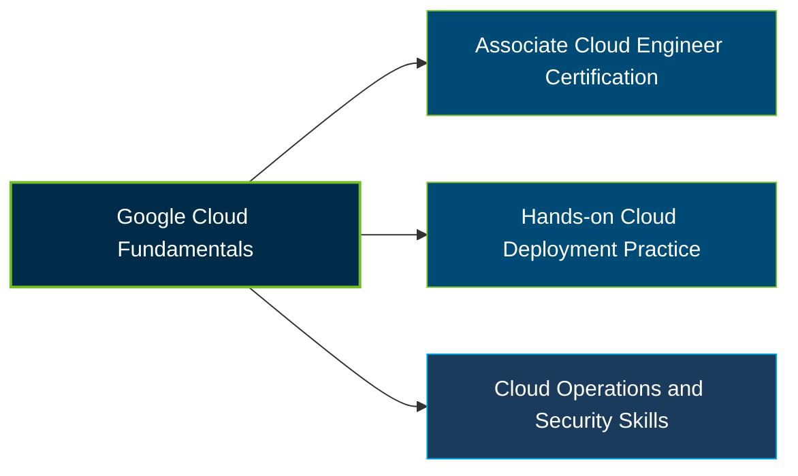

# Google Associate Cloud Engineer Certification Exam Guide

A dedicated, comprehensive study guide and cloud infrastructure reference repository for candidates preparing for the **Google Cloud Associate Cloud Engineer Certification Exam**.

---

## Exam Overview

The Google Cloud Associate Cloud Engineer certification validates practical skills in deploying and securing applications, configuring cloud infrastructure, managing projects, and maintaining reliable solutions on Google Cloud.

- **Exam Format**: Multiple-choice and multiple-select questions; online-proctored or onsite-proctored exam
- **Target Audience**: Cloud Engineers, Cloud Administrators, Infrastructure Engineers, and IT professionals managing Google Cloud resources
- **Prerequisites**: None; Google Cloud recommends 6+ months of hands-on experience with Google Cloud

---

## Core Exam Domains & Knowledge Areas

### 1. Setting Up a Cloud Solution Environment

- Creating cloud projects, resource hierarchies, organizational policies, and IAM assignments.
- Enabling APIs, managing users and groups, and configuring Google Cloud services.
- Managing billing accounts, budgets, alerts, quotas, and billing exports.

### 2. Planning and Implementing a Cloud Solution

- Selecting and deploying compute resources, including Compute Engine, Google Kubernetes Engine, and Cloud Run.
- Choosing storage, database, data, and networking services for workload requirements.
- Implementing infrastructure as code and configuring cloud resources for availability and scalability.

### 3. Ensuring Successful Operation of a Cloud Solution

- Managing compute instances, GKE clusters, Cloud Run applications, and autoscaling.
- Maintaining storage and data solutions, backups, databases, and network resources.
- Monitoring metrics, logs, alerts, and application health with Google Cloud observability tools.

### 4. Configuring Access and Security

- Creating and managing Identity and Access Management (IAM) policies and roles.
- Configuring service accounts and applying least-privilege permissions.
- Managing service account access, impersonation, and short-lived credentials.

---

## Certification Path

This is a suggested learning progression, not an official prerequisite or mandatory certification sequence.

---

## Recommended Practice & Study Resources

Combine official Google Cloud training with hands-on deployment and operations practice to strengthen your cloud engineering skills.

- **CertsGate**: Explore [Google Associate Cloud Engineer exam preparation resources](https://certsgate.com/exams/google/associate-cloud-engineer) for supplementary study materials and practice questions.
- **Google Cloud Documentation**: Use the [Google Cloud documentation](https://cloud.google.com/docs) and hands-on labs to practice deploying resources, configuring IAM, managing networks, and monitoring workloads.
